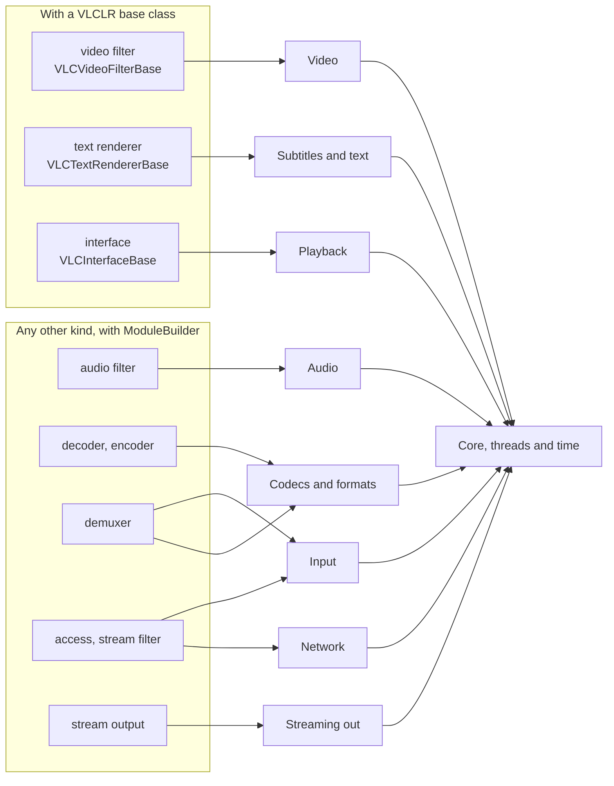

<h1 align="center">
  <picture>
    <source media="(prefers-color-scheme: dark)" srcset="assets/logo-dark.svg">
    
  </picture>
</h1>

> Early development: APIs may change between releases.

**VLC + CLR = VLCLR** is a framework for writing VLC 4.x plugins in C# and
publishing them as Native AOT libraries that VLC loads directly, with no C shim.

Targets VLC 4.0.6 and .NET 10 on:

- Windows x64
- Linux x64
- macOS arm64 and x64

CI builds the plugins and runs them inside VLC 4 nightlies on every platform.

## Minimal plugin

```csharp
using VLCLR.Plugin;

[VLCModule("my_filter")]
[VLCCapability("video filter", Score = 0)]
[VLCDescription("My C# video filter")]
public partial class MyFilter : VLCVideoFilterBase
{
    protected override void ProcessFrame(VLCFrame frame)
    {
        // Inspect or modify the negotiated VLC picture.
    }
}
```

The source generator supplies `vlc_entry`, module registration, native
callbacks, exception handling, and per-instance state. Advanced plugins can use
`VLCLR.Module.ModuleBuilder` directly.

## No allocations per frame

Each plugin has its own garbage collector. One whose frames allocate keeps
several MB more and makes the GC run while video plays; one that allocates
nothing per frame costs about 0.5 MB. Allocate in `OnOpen` or on the first
frame, and reuse buffers. Two tools check it:

- **Analyzer VLCLR001** (on by default) reports, on build, what the overrides
  of `ProcessFrame`, `ProcessFrameToOutput` and `SetOutputProperties`, the
  methods marked `[VLCPerFrame]`, and the methods of the project they call
  allocate. It does not see inside other libraries.
- **`-p:VLCLRFrameAllocationCheck=true`** builds the plugin so that each video
  filter logs, when it closes, what its frames allocated after a three-frame
  warm-up, as a warning when anything:
  `Frame allocations: none in 22 frames after a warm-up of 3`. It counts
  everything, libraries included. Off by default: the AOT compiler then
  leaves the measurement out. `tests/VlcEndToEnd/run.sh` turns it on and fails
  on any allocating filter.

## What libvlccore offers

A VLC plugin is a module of one kind (video filter, decoder, demuxer, ...)
that calls into libvlccore, VLC's core library. VLCLR has base classes for
three kinds; any other kind is registered with `ModuleBuilder` and uses the
generated bindings directly.



`VLCLR.Native.Interop` binds the whole libvlccore C API, generated from the
headers VLC installs for plugins: every exported function, struct, enum and
constant, for Windows, Linux and macOS. The hand-written wrappers on top of it
cover the areas VLCLR's samples need so far.

| Area | Headers | What it offers | C# wrappers |
|---|---|---|---|
| Playback | `vlc_player.h`, `vlc_playlist.h`, `vlc_input_item.h`, `vlc_media_source.h`, `vlc_preparser.h`, `vlc_meta.h` | Player control, tracks, playlists, media items, metadata, preparsing | `VLCPlayer`, `VLCPlaylist` |
| Video | `vlc_picture.h`, `vlc_filter.h`, `vlc_vout*.h`, `vlc_window.h`, `vlc_opengl*.h`, `vlc_ancillary.h`, `vlc_fourcc.h` | Pictures and pools, filters, video output and windows, OpenGL, HDR metadata, chromas | `VLCVideoFilterBase`, `VLCFrame`, `VLCFourCC` |
| Subtitles and text | `vlc_subpicture.h`, `vlc_spu.h`, `vlc_text_style.h` | Subpictures and regions, text styles, text rendering | `VLCTextRendererBase`, `VLCSubpicture`, `VLCTextStyle` |
| Audio | `vlc_aout.h`, `vlc_aout_volume.h`, `vlc_replay_gain.h` | Audio output, volume, replay gain | `VLCAudioFormat` (format only) |
| Codecs and formats | `vlc_es.h`, `vlc_codec.h`, `vlc_decoder.h`, `vlc_frame.h` | Elementary stream formats, decoders and encoders, data blocks | `VLCEsFormat`, `VLCBlock` (types only) |
| Input | `vlc_stream.h`, `vlc_demux.h`, `vlc_access.h`, `vlc_stream_extractor.h`, `vlc_es_out.h` | Byte streams, demuxers, access modules, archives | |
| Streaming out | `vlc_sout.h`, `vlc_httpd.h`, `vlc_vlm.h` | Stream output chains, HTTP server, VLM | |
| Network | `vlc_network.h`, `vlc_tls.h`, `vlc_http.h`, `vlc_url.h`, `vlc_keystore.h` | Sockets, TLS, HTTP client, URLs, credentials | |
| Core | `vlc_objects.h`, `vlc_variables.h`, `vlc_configuration.h`, `vlc_modules.h`, `vlc_messages.h`, `vlc_interface.h`, `vlc_dialog.h` | Objects, variables, configuration, modules, logging, interfaces, dialogs | `VLCObject`, `VLCVariable`, `VLCConfiguration`, `VLCLogger` |
| Threads and time | `vlc_threads.h`, `vlc_tick.h`, `vlc_interrupt.h`, `vlc_executor.h`, `vlc_queue.h` | Threads, locks, clocks, interruption, thread pools | `VLCTick` (time units only) |
| Media library | `vlc_media_library.h`, `vlc_fingerprinter.h` | Library database, playback states | |
| Utilities | `vlc_strings.h`, `vlc_charset.h`, `vlc_fs.h`, `vlc_xml.h`, `vlc_hash.h`, `vlc_memstream.h`, ... | Strings, character sets, files, XML, hashing, memory streams | |

Without a wrapper, call the C API as it is: `vlc_player_GetTime(player)` is
`VlcPlayer.GetTime(player)`, and structs keep their C layout with per-platform
offsets. Static inline functions are not bound; the few VLCLR needs are
reimplemented in C#. `src/VLCLR/Native/Interop/cimport-report.md` lists what
is not bound, and why. See [`tools/VLCLR.CImport`](tools/VLCLR.CImport/README.md)
for how the bindings are generated and kept in step with VLC.

## Samples

| Sample | Capability | Platforms |
|---|---|---|
| [VideoOverlay](samples/VideoOverlay/README.md) | CPU video filter with ImageSharp text and graphics | Windows, Linux, macOS |
| [SubtitleRenderer](samples/SubtitleRenderer/README.md) | ImageSharp text renderer | Windows, Linux, macOS |
| [GaussianBlur](samples/GaussianBlur/README.md) | Port of VLC's Gaussian blur video filter with the same output, SIMD included | Windows, Linux, macOS |
| [Yadif](samples/Yadif/README.md) | Port of VLC's yadif deinterlacer with the same output, SIMD included | Windows, Linux, macOS |
| [McpRemote](samples/McpRemote/README.md) | Interface module that lets AI agents control VLC over the Model Context Protocol | Windows, Linux, macOS |

### Advanced samples

These are closed source and available under the commercial license.

| Sample | Capability |
|---|---|
| Privacy Shield | Real-time redaction of people, faces, and license plates during playback, with solid, mosaic, or blur effects. GPU-accelerated end to end |
| Semantic Video Navigator | Describe a moment in plain words and jump straight to it. Indexing runs in the background while playback stays smooth |
| Shader Studio | GPU-accelerated live effects (CRT, Comic, Neon, VHS, Noir, Halftone, Temporal Echo), switched instantly from a panel inside VLC |
| Live Audio Translator | Live speech translation: listens to the audio track, transcribes and translates it, and shows the result as subtitles |
| Subtitle Translator | Offline English-to-French subtitle translation with a local ONNX model, inside the text renderer |
| Object Search | YOLOX object detection on the GPU (D3D11 and OpenVINO), with boxes and labels drawn over the video |

## Requirements

- .NET SDK 10.0.102
- A Native AOT toolchain: MSVC with `vswhere.exe` in `PATH` on Windows, clang
  on Linux, Xcode command line tools on macOS
- A VLC 4 development build compatible with plugin API 4.0.6
- On Windows, `lib/libvlccore.lib` when publishing plugins

## Build and test

```sh
dotnet build vlclr.sln -c Release
dotnet test src/VLCLR.Tests -c Release
dotnet publish samples/VideoOverlay -c Release
```

`dotnet publish` targets the current OS and architecture.

## Repository map

| Path | Purpose |
|---|---|
| `src/VLCLR/` | Core bindings, wrappers, module registration, and plugin base classes |
| `src/VLCLR/Native/Interop/` | The whole libvlccore C API, generated from VLC's headers by `tools/VLCLR.CImport`: raw, and changing when the headers do |
| `src/VLCLR.Generators/` | Attribute-based VLC module source generator |
| `src/VLCLR.ImageSharp/` | Frame and text-rendering helpers |
| `src/VLCLR.Filters/` | Ports of VLC's video filters |
| `samples/` | Native AOT plugin examples, each with its own guide |
| `tests/` | Unit, ABI, integration, and visual tests |
| `benchmarks/` | Rendering and filter performance measurements |

## License

VLCLR is dual-licensed:

- **Open source**: [GNU General Public License v2.0 or later](LICENSE).
- **Commercial**: for use in proprietary software without GPL obligations,
  contact [@mfkl](https://github.com/mfkl).

Third-party components keep their own licenses.
